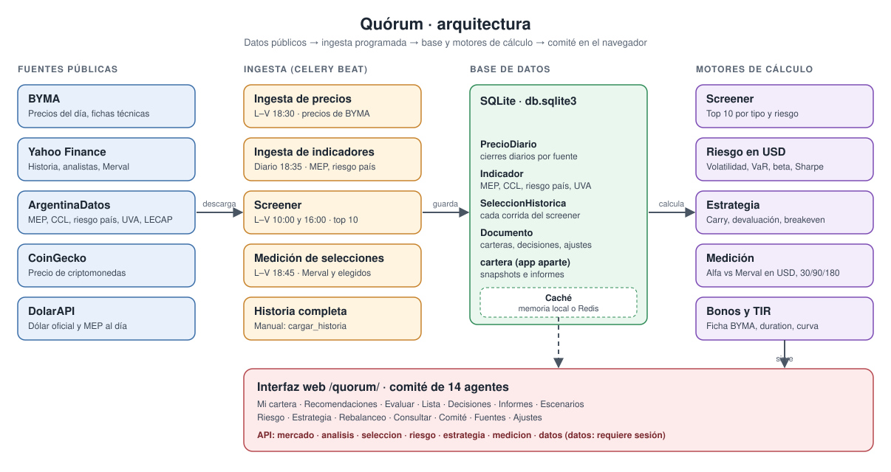
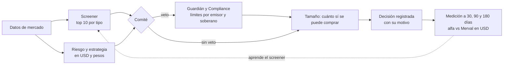

# Landgraft

**Comité de inversión para Argentina, en tu propio servidor.** Landgraft junta precios de BYMA, datos de Yahoo Finance y las series de ArgentinaDatos, y con eso arma un screener de acciones, CEDEAR, bonos, letras y ON; mide el riesgo de tu cartera en dólares MEP; compara pesos contra dólar y tasa fija contra CER; y te dice cuánto aportar para volver a tu objetivo sin vender nada. Cada decisión queda registrada y, después, se mide contra el mercado.

> **Aviso.** Landgraft es una herramienta informativa. **No es asesoramiento financiero** ni una recomendación de compra o venta. Los datos vienen de fuentes públicas que pueden tener errores o retrasos. Las decisiones son tuyas.

---

## Índice

1. [Qué es](#qué-es)
2. [Qué hace](#qué-hace)
3. [Arquitectura](#arquitectura)
4. [El comité: 14 agentes](#el-comité-14-agentes)
5. [Cómo se calcula](#cómo-se-calcula)
6. [Requisitos](#requisitos)
7. [Instalación](#instalación)
8. [Variables de entorno](#variables-de-entorno)
9. [Primera carga de datos](#primera-carga-de-datos)
10. [Puesta en marcha](#puesta-en-marcha)
11. [Tareas programadas](#tareas-programadas)
12. [API](#api)
13. [Pruebas](#pruebas)
14. [Estructura del repositorio](#estructura-del-repositorio)
15. [Problemas frecuentes](#problemas-frecuentes)
16. [Limitaciones conocidas](#limitaciones-conocidas)
17. [Licencia](#licencia)

---

## Qué es

Landgraft es una aplicación web en **Django** (con **Celery** para las tareas programadas) pensada para una cartera en pesos y dólares en Argentina. Tiene dos partes:

- **Un backend** que cada día hábil lee BYMA, las series de ArgentinaDatos y las cotizaciones de Yahoo Finance y CoinGecko, guarda todo en una base y corre los cálculos: screener, riesgo, estrategia y medición.
- **Un comité en el navegador**: 14 "agentes" que revisan tu cartera. Algunos son reglas, otros son cálculos, y dos tienen poder de veto (el Guardián y el de Compliance). Cada uno explica su conclusión en lenguaje claro.

Lo que la diferencia de un simulador: **no ejecuta órdenes** y **no decide por vos**. Te muestra la evidencia, marca los límites que no querés romper y guarda la historia para que puedas comprobar si el screener acierta.

---

## Qué hace

| Área | Qué te da |
|---|---|
| **Screener** | Los 10 mejores de cada tipo: acciones, CEDEAR, bonos, letras y ON. Se recalcula dos veces por día hábil. |
| **Riesgo en USD** | Volatilidad, VaR y CVaR a 10 días, máxima caída, Sharpe, Sortino, **beta y alfa frente al Merval**, y la contribución de cada posición al riesgo total. |
| **Estrategia** | Carry (cuánto tendría que subir el MEP para que pasarse a dólares rinda más), devaluación implícita de los dollar linked y breakeven de inflación contra CER. |
| **Medición** | Liquida cada selección del screener a 30, 90 y 180 días: rendimiento en USD y **alfa frente al Merval en USD**. Así sabés si el screener acierta. |
| **Rebalanceo** | Bandas de tolerancia por grupo. Sugiere ventas si hace falta, y con **"aportar sin vender"** reparte tu próxima aportación hacia los grupos que quedaron por debajo del objetivo. |
| **Bonos y TIR** | TIR a partir de la ficha técnica de BYMA: flujos, cupón corrido, duration. Incluye CER cero cupón, LECAP y soberanos ley Nueva York. |
| **Decisiones y lista** | Lista de seguimiento, registro de decisiones y datos de tu cartera, guardados por usuario en la base. |
| **Varios usuarios** | Cada usuario tiene sus datos separados. Los endpoints de datos exigen sesión. |

---

## Arquitectura



El flujo tiene cuatro capas:

1. **Fuentes públicas.** BYMA (precios y fichas técnicas), Yahoo Finance (historia, analistas y el índice Merval), ArgentinaDatos (MEP, CCL, riesgo país, UVA, LECAP, tasas e inflación), CoinGecko (cripto) y DolarAPI (dólar al día).
2. **Ingesta programada.** Celery Beat dispara las tareas en horario de mercado. Cada tarea guarda en la base y deja el resultado en caché. Si BYMA no tiene precios vigentes (antes de la apertura, publica todo en cero), se usa el último respaldo, marcado como desactualizado.
3. **Base de datos y caché.** SQLite por defecto. Guarda cierres diarios por fuente, indicadores, cada selección del screener y los datos de cada usuario. La caché es memoria local, o Redis si está configurado (recomendado si corren Celery y el servidor web a la vez).
4. **Motores y comité.** Los módulos de cálculo leen la base. El comité en el navegador pide los resultados por la API y los muestra. Los agentes del comité viven en el navegador y trabajan sobre la cartera que cada usuario carga.

### Flujo de una decisión



---

## El comité: 14 agentes

Cada agente tiene un rol fijo. Los que dicen **Código** son cálculos deterministas; los que dicen **Reglas** aplican criterios escritos. Nada se decide con un modelo de lenguaje sin control.

| Agente | Qué revisa | Motor | Veto |
|---|---|---|---|
| AI Fuentes | Qué fuentes están activas y si algún dato puede estar viejo | Código | |
| AI Dólar | MEP, CCL y brecha. Valúa la cartera en pesos y en dólares | Código | |
| AI Acciones | Acciones y CEDEAR: ganancia, peso y señales de reducir o revisar | Reglas | |
| AI Renta Fija | Bonos, letras, ON y caución contra la tasa de referencia de su moneda | Código | |
| AI Macro | Inflación esperada y tasas, como contexto | Código | |
| AI Noticias | Hechos relevantes que afectan una posición | Reglas | |
| AI Liquidez | Caja, vencimientos próximos y liquidez mínima | Código | |
| AI Guardián | Límite por emisor. **Puede vetar una compra** | Código | Sí |
| AI Escenarios | Pérdida ante devaluación, suba de tasas y caída del Merval | Código | |
| AI Compliance | Límite de renta fija soberana y listas restringidas. **Puede vetar** | Código | Sí |
| AI Tamaño | Si hay veto, calcula cuánto sí se puede comprar | Código | |
| AI Comité | Decide y explica el motivo. Redacta los informes | Reglas | |
| AI Fiscal | Estima la ganancia realizada de una venta. Orientativo | Reglas | |
| AI Memoria | Registra cada decisión y la mide después | Código | |

El comité también ofrece perfiles de cartera (Conservador, Moderado, Agresivo, Carry en pesos, Dolarización, Renta en dólares y Crecimiento), cada uno con su reparto objetivo por grupo.

---

## Cómo se calcula

Los criterios completos están en el código y en la pantalla de Selección. Este es el resumen.

**Screener, renta variable (acciones y CEDEAR).** Se toman los más operados de BYMA. Se exige un mínimo de analistas (3 en acciones, 10 en CEDEAR), se descartan caídas fuertes de seis meses y la suba esperada tiene techo (80 % y 60 %). El puntaje es la suba esperada, recortada a la mitad (los precios objetivo son optimistas) y dividida por la volatilidad, con ajuste por consenso y tendencia.

**Screener, renta fija.** Se mide la TIR sobre el precio sucio (con cupón corrido), con la duration modificada. Se compara contra la referencia de cada moneda: plazo fijo llevado a TEA en pesos, curva soberana en dólares, o plazo fijo en términos reales para CER. Se elige lo mejor de cada segmento y se alternan, para no dejar afuera ninguna moneda. Se descartan TIR extremas, que suelen indicar default o falta de liquidez, y los duplicados por ISIN.

**Riesgo.** Todo se mide en dólares MEP, porque en pesos la inflación esconde el riesgo. Cada posición tiene su serie diaria en USD: acciones y CEDEAR por precio ÷ MEP; renta fija en pesos por su tasa contra el MEP; bonos en dólares por riesgo país × duration. El beta y el alfa de Jensen usan el Merval en USD como mercado.

**Medición.** Cada selección se liquida a 30, 90 y 180 días. El rendimiento es precio ÷ MEP, de cierre a cierre. La entrada usa el último cierre **anterior** al día del cálculo, para no mirar el futuro. El alfa es el rendimiento del elegido menos el del Merval en USD en el mismo período. Bonos, letras y ON no se miden por precio: su TIR se cumple al vencimiento.

**Rebalanceo.** Si un grupo se sale de su banda, se sugieren ventas (primero lo que está en pérdida, para realizarla) o compras. Con "aportar sin vender", la plata nueva se reparte entre los grupos por debajo del objetivo, en proporción a lo que les falta.

---

## Requisitos

- **Python 3.12** (es la versión con la que se probó el proyecto).
- **Git.**
- Opcional pero recomendado: **Redis**, para la caché compartida y como broker de Celery.
- Opcional: una clave de **Anthropic** para la redacción de informes de la app `cartera`.
- Conexión a internet: BYMA, Yahoo Finance, ArgentinaDatos, CoinGecko y DolarAPI.

Las dependencias están fijadas en `requirements.txt`: Django 5.2, Celery 5.7, yfinance, pandas, numpy y requests, entre otras.

---

## Instalación

### Windows (PowerShell)

```powershell
git clone <URL-del-repositorio> tradingMarket
cd tradingMarket

# 1. Entorno virtual
python -m venv .venv
.venv\Scripts\Activate.ps1

# 2. Dependencias
pip install -r requirements.txt

# 3. Configuración: copiar y completar
copy .env.example .env
# Editar .env: al menos DJANGO_SECRET_KEY (ver más abajo cómo generarla)

# 4. Base de datos y usuario
.venv\Scripts\python.exe manage.py migrate
.venv\Scripts\python.exe manage.py createsuperuser
```

### macOS y Linux

```bash
git clone <URL-del-repositorio> tradingMarket
cd tradingMarket

python3 -m venv .venv
source .venv/bin/activate

pip install -r requirements.txt
cp .env.example .env   # y completar

python manage.py migrate
python manage.py createsuperuser
```

### Generar la clave secreta

```bash
python -c "import secrets; print(secrets.token_urlsafe(50))"
```

Pegá el resultado en `DJANGO_SECRET_KEY` dentro de `.env`. Sin esa variable, la app no arranca fuera de modo desarrollo.

### Redis (opcional, recomendado)

Sin Redis, la caché es local a cada proceso. Eso alcanza para uso individual, pero Celery y el servidor web no comparten datos. Para usarlo:

- **Docker:** `docker run -d -p 6379:6379 --name redis redis:7`
- **Windows:** WSL con `sudo apt install redis-server`, o Memurai.
- **macOS:** `brew install redis && brew services start redis`.

Después, definí `REDIS_URL=redis://localhost:6379/0` en `.env`.

---

## Variables de entorno

Estas variables se leen desde `.env` (o desde el entorno). El archivo `.env` **no se versiona**.

| Variable | Obligatoria | Qué hace |
|---|---|---|
| `DJANGO_SECRET_KEY` | Sí, salvo en desarrollo | Clave de Django. Generala con el comando de arriba. |
| `DJANGO_DEBUG` | No | `1` para desarrollo. En `0` la app exige `DJANGO_SECRET_KEY`. |
| `DJANGO_ALLOWED_HOSTS` | No | Hosts permitidos, separados por coma. Por defecto `localhost,127.0.0.1`. |
| `REDIS_URL` | No | Caché compartida. Si está vacía, se usa memoria local. |
| `CELERY_BROKER_URL` | No | Broker de Celery. Por defecto, `REDIS_URL` o `redis://localhost:6379/0`. |
| `ANTHROPIC_API_KEY` | No | Solo para la redacción de informes de la app `cartera`. |

---

## Primera carga de datos

El screener y los indicadores necesitan historia para funcionar. Con la base vacía, la primera carga toma unos minutos:

```bash
python manage.py cargar_historia
```

Opciones:

- `--dias 365`: días de historia de precios (por defecto, 365).
- `--especies 60`: cuántas acciones y CEDEAR, de las más operadas (por defecto, 60).

El comando baja los indicadores de ArgentinaDatos (tres años), los precios del día de BYMA, la historia de Yahoo Finance, la de CoinGecko y la del Merval. Sin esta carga, el riesgo y la medición avisan que no hay historia suficiente.

---

## Puesta en marcha

Landgraft necesita tres procesos. Cada uno en su terminal, con el entorno virtual activado.

**1. Servidor web**

```bash
python manage.py runserver
```

Abrí `http://localhost:8000/landgraft/`. Ingresá con el usuario que creaste en `createsuperuser`.

**2. Worker de Celery** (ejecuta las tareas)

```bash
# macOS y Linux
celery -A trading worker --loglevel=info

# Windows: Celery necesita el pool "solo"
celery -A trading worker --loglevel=info --pool=solo
```

**3. Beat de Celery** (dispara las tareas en su horario)

```bash
celery -A trading beat --loglevel=info
```

Sin el worker, las tareas no corren. Sin el beat, no se programan. Para dispararlas a mano (con el worker levantado), usá `manage.py shell` con `from landgraft.tasks import calcular_seleccion; calcular_seleccion.delay()`.

La app también puede lanzar el screener sola: si pedís la selección y no hay una vigente, la calcula en un hilo en segundo plano.

---

## Tareas programadas

Todas usan la hora de Buenos Aires y corren de lunes a viernes salvo que se indique.

| Tarea | Horario | Qué hace |
|---|---|---|
| `landgraft.tasks.ingestar_precios` | 18:30 | Guarda el precio del día de BYMA |
| `landgraft.tasks.ingestar_indicadores` | 18:35 (todos los días) | Actualiza MEP, CCL, riesgo país, UVA, inflación y plazo fijo |
| `landgraft.tasks.calcular_seleccion` | 10:00 y 16:00 | Recalcula el screener |
| `landgraft.tasks.preparar_medicion` | 18:45 | Baja la historia del Merval y de los elegidos que aún no la tienen |
| `analysisActions.tasks.actualizar_cedears_task` | Cada 20 min, 11–17 h | Actualiza los CEDEAR |
| `cartera.tasks.registrar_snapshots` | 18:00 | Guarda el valor diario de cada cartera |
| `cartera.tasks.generar_informes` | 18:15 diario · día 1 mensual · 1 de enero anual | Informes de la cartera |

---

## API

Todas las rutas empiezan con `/landgraft/api/`. Las respuestas son JSON.

| Ruta | Método | Descripción | Sesión |
|---|---|---|---|
| `mercado/` | GET | Dólar (oficial, MEP, CCL), criptos y tasas. Se actualiza cada minuto | No |
| `analisis/?simbolos=GGAL,AL30` | GET | Información por activo: BYMA, Yahoo Finance y CoinGecko. Hasta 60 símbolos | No |
| `seleccion/` | GET | Último resultado del screener. Devuelve 202 mientras se calcula | No |
| `riesgo/` | POST | Riesgo de una cartera. Cuerpo: `{"posiciones": [...]}` | No |
| `estrategia/` | GET | Carry, devaluación implícita y breakeven de inflación | No |
| `medicion/` | GET | Alfa de las selecciones a 30, 90 y 180 días. Devuelve 404 si no hay selecciones | No |
| `sesion/` | GET | Estado de la sesión y token CSRF | No |
| `datos/<clave>/` | GET, PUT, DELETE | Guarda o lee los datos del usuario (carteras, decisiones, ajustes). Máximo 2 MB | Sí |

Las escrituras a `datos/` exigen el token CSRF de `sesion/` en el encabezado `X-CSRFToken`.

---

## Pruebas

```bash
python manage.py test landgraft
```

Son 24 pruebas: API de datos y de sesión, cálculo de TIR y cupón corrido, cronograma del GD30, liquidación de 24 horas, riesgo en USD, beta, estrategia y medición. Las pruebas no llaman a internet: usan datos fabricados.

Para el código de la interfaz:

```bash
node --check landgraft/static/landgraft/funciones.js
node --check landgraft/static/landgraft/front.js
```

Verificación del sistema:

```bash
python manage.py check
```

---

## Estructura del repositorio

```
tradingMarket/
├── trading/                  Configuración del proyecto: settings, urls, celery
├── landgraft/                Comité, screener, riesgo, estrategia y medición
│   ├── byma.py               BYMA: precios, fichas técnicas, TIR y CER
│   ├── yahoo.py              Yahoo Finance: analistas, precio objetivo, volatilidad
│   ├── seleccion.py          Screener de acciones, CEDEAR, bonos, letras y ON
│   ├── riesgo.py             Riesgo en USD, beta y alfa
│   ├── estrategia.py         Carry, devaluación implícita y breakeven
│   ├── medicion.py           Alfa de cada selección a 30, 90 y 180 días
│   ├── historia.py           Carga de precios e indicadores en la base
│   ├── servicio_seleccion.py Cálculo del screener en segundo plano
│   ├── views.py, urls.py     API y página del comité
│   ├── tasks.py              Tareas de Celery
│   ├── models.py             Documento, PrecioDiario, Indicador, SeleccionHistorica
│   ├── management/commands/  cargar_historia
│   ├── static/landgraft/     Interfaz: funciones.js (cálculo), front.js (pantalla)
│   └── test_*.py, tests.py   Pruebas
├── cartera/                  Snapshots diarios e informes (con Claude opcional)
├── analysisActions/          Análisis de acciones y actualización de CEDEAR
├── docs/
│   ├── arquitectura.svg      Diagrama de arquitectura
│   └── especificacion-mejoras.md  Plan de mejoras
├── manage.py
├── requirements.txt
└── .env.example
```

---

## Problemas frecuentes

**"Falta DJANGO_SECRET_KEY"**
Creá `.env` a partir de `.env.example` y generá la clave con el comando de la sección de instalación. Si estás en desarrollo, `DJANGO_DEBUG=1` permite arrancar sin clave.

**El screener muestra "calculando" y nunca termina**
Revisá el terminal del worker de Celery. Si no hay worker, el cálculo se lanza en un hilo y puede tardar varios minutos (cientos de especies, consultas a Yahoo). El progreso aparece en `/landgraft/api/seleccion/`.

**BYMA muestra precios en cero**
Es normal antes de la apertura del mercado. Landgraft usa el último respaldo guardado y lo marca como desactualizado en la respuesta.

**"No hay historia del MEP en la base"**
Corré `python manage.py cargar_historia`. El riesgo y la medición necesitan los indicadores.

**Yahoo Finance devuelve errores o "Too Many Requests"**
Es un límite de pedidos. Landgraft guarda el error solo cinco minutos y sigue con el resto. Si persiste, esperá un rato y volvé a cargar.

**Windows: el worker de Celery no arranca o se cae**
Usá `--pool=solo`, que es el pool que funciona en Windows (ver la sección de puesta en marcha).

**`pip install` falla con pandas o numpy**
Usá Python 3.12, con el que se probó el proyecto. Las versiones fijadas en `requirements.txt` son de esa época.

---

## Limitaciones conocidas

- **Fuentes públicas.** BYMA, Yahoo Finance y ArgentinaDatos pueden atrasarse o cambiar su formato. Cada fuente falla por separado y se informa.
- **Muestra chica.** La medición tiene sentido con decenas de selecciones. Con pocas, cualquier promedio es ruido.
- **El criterio de analistas no se puede backtestear.** Yahoo solo da el precio objetivo actual, no su historia. La medición hacia adelante es el único método honesto para esa parte.
- **Renta fija en dólares.** Su riesgo se aproxima con el riesgo país y la duration, no con el precio de mercado de cada bono.
- **Ganancias fiscales.** La estimación de AI Fiscal es orientativa. No reemplaza al contador.
- **Sin ejecución.** Landgraft no compra ni vende. Las órdenes se ejecutan en tu broker.

---

## Licencia

**Pendiente.** El repositorio todavía no tiene un archivo `LICENSE`. Hasta que se agregue, el código no tiene una licencia de uso explícita.
